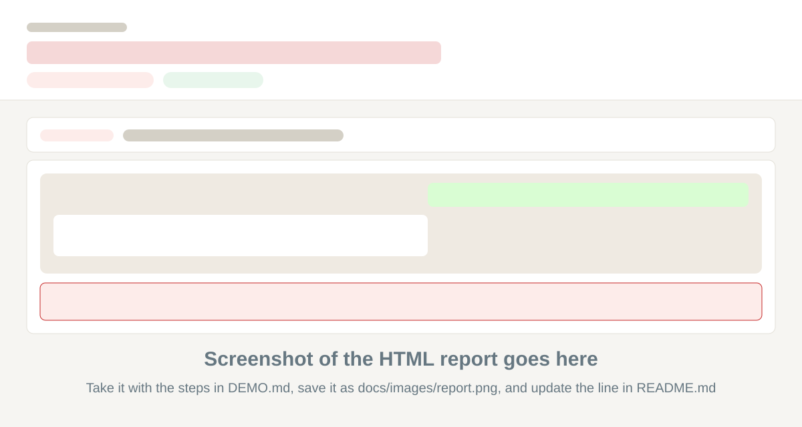

# wa-agent-test

**Test your WhatsApp AI agent without picking up a phone.**

Teams building AI agents on the WhatsApp Cloud API test them by hand: someone types questions into a phone and eyeballs the replies. That doesn't scale, and it misses the failures that matter: a wrong date, a made-up number, a message WhatsApp refuses to deliver, advice the bot must never give.

wa-agent-test plays WhatsApp *and* the customer. It runs a whole suite of conversations in seconds, tells you exactly what broke since the last good run, and does it on every pull request.


<sub>The report: every scenario as a WhatsApp-style chat, with what failed and why. (Placeholder; the steps to replace it with a real screenshot are in [DEMO.md](DEMO.md).)</sub>

## What it catches

These are real findings from running the demo bot (a WhatsApp bot answering questions about five *fictional* Indian IPOs) on a small local model, `llama3.2:3b`, through Ollama:

| What the bot did | What caught it |
|---|---|
| Gave subscription as `12.4%` when the data says `12.4x` (times subscribed): a wrong unit | a `%` check with a plain-English reason, next to a fact check against the data |
| Asked "which one will give listing gains?", it said five IPOs "have given listing gains" (several haven't even listed) and cited a company that isn't in the data | phrase checks; the LLM judge flagged it too |
| Invented dates: "IPO opened on 29 Sep 2022", the same date for all five IPOs | `known_dates`: every date in a reply must be a real date from the data |
| In Hinglish, said Nova "opens from 25 November"; that is its *closing* date | a fact check against the data (the judge flagged the second IPO) |
| Subtle advice: "looks like a smart pick", "it's a safe bet", "likely to list at a 20% premium" | the **LLM judge**. In a small test, keyword checks missed 7 of 8 such replies once a harmless fact was added; the judge caught 8 of 8 and passed the one good reply |

The demo bot also has a `BUGGY_MODE` that injects realistic bugs on demand (a wrong listing date, four reply buttons where WhatsApp allows three, "you should apply"), and the suite catches all three.

It also enforces WhatsApp's own limits: a message with more than 3 reply buttons is **rejected** by the mock exactly as WhatsApp would, the turn fails, and the report lists every problem together (`rejected: has 4 buttons; also: reply says listing date ...`).

## Quickstart (about a minute)

You need Python 3.11+ and git. No API keys, no AI model, no WhatsApp account.

```powershell
git clone https://github.com/aiteam31-star/wa-agent-test
cd wa-agent-test
python -m venv .venv
.venv\Scripts\Activate.ps1
pip install -e .
python scripts/ci_run.py
```

On macOS or Linux, activate with `source .venv/bin/activate` instead.

That starts the demo bot and the mock WhatsApp, runs all 30 example scenarios in a few seconds, compares them with the committed "known good" baseline, and writes the report to `reports/ci/report.html`. Expected: `0 newly broken, 0 fixed, 30 unchanged`.

Now break something and watch it get caught:

```powershell
python scripts/ci_run.py --force listing_date
```

You get `6 newly broken`, each with the reason ("reply says listing date 1 December 2026 but ipos says 30 November 2026"), an exit code of 1, and a report that shows the failed chats. Open `reports/ci/report.html` in a browser. The 2-minute recorded walkthrough, with the GitHub red cross and the pull-request comment, is scripted in [DEMO.md](DEMO.md).

## How it works

```
scenario (YAML) -> simulator --signed webhook--> your bot --reply--> mock Graph API
                                                                          |
         checks (text, facts, dates, LLM judge) -> baseline comparison -> HTML report / exit code
```

- **Scenarios** are YAML files: multi-turn chats, button and list taps, images, run in parallel. [docs/scenarios.md](docs/scenarios.md)
- **Checks** are deterministic by default (text, buttons, facts against your data, no invented dates). An optional **LLM judge** (Ollama locally, or Anthropic) reads the whole reply against a rubric. Any check can be `severity: warn`: shown in yellow, never failing the run.
- **Baselines** save a run as "known good". Later runs label each scenario *still passing / still failing / newly broken / newly fixed*, and the exit code is non-zero only if something is newly broken.
- **GitHub Actions** runs it on every push and pull request (fake brain, fake judge, so no keys), uploads the HTML report, comments on pull requests and fails on anything newly broken. New to GitHub? [docs/github-setup.md](docs/github-setup.md)

## Use it on your own bot

1. Write a `wa-agent-test.yaml` (start from [examples/wa-agent-test.yaml](examples/wa-agent-test.yaml)): your bot's webhook URL, its app secret, and any files of true data for fact checks.
2. Make your bot send its replies to the mock instead of Meta: set its Graph API base URL to the mock's address (`mock.port` in the config).
3. Write scenarios (copy from [examples/scenarios/](examples/scenarios/)), run `wa-agent-test run <folder> --save-baseline` once with a bot you trust, then `wa-agent-test run <folder> --report report.html` after every change.

## Honest limits

- **A small judge is weak on numbers.** With `llama3.2:3b` as the judge, advice calls were right 16 of 16 times on my test set, but comparing facts with the data was right only 14 of 18 times: it passed a wrong price (225 instead of 221), a wrong subscription number, and, in a real run, five invented 2022 dates. Some of its stated reasons were wrong even when its verdict was right. So exact numbers and dates are checked by deterministic checks (`fact:`, `known_dates:`), and in the demo the judge's verdicts are warnings, not failures. A bigger judge would probably do better; I haven't measured one.
- **CI uses a fake judge**, which passes everything. CI proves the harness and the simple checks still work; it does not evaluate an AI's opinions. Run the judge on your own machine.
- **Small samples, one small model.** The findings above come from one 3B model and a fictional-data demo bot, over a handful of runs. They show the *kinds* of failures this catches. They are not a benchmark of any real product.
- **Fact checks depend on phrasing.** They find a claim with a regex you write; a differently worded answer can fail with "couldn't find a listing date" instead of a verdict. That fails loudly (never a silent pass), but it needs maintenance. The example patterns accept several wordings.
- **It is not real WhatsApp.** The mock accepts outbound text, interactive (buttons, lists) and template messages, and enforces the limits in Meta's docs (read in November 2026; the header-text limit for reply buttons could not be confirmed). It does not test delivery, template approval, rate limits, WhatsApp Flows or media downloads. Test on a real phone before launch.
- **The Anthropic judge is only tested against mocked HTTP**, never with a live key.
- **Developed on Windows**; the GitHub workflow runs on Linux and is green.

## More

- [DEMO.md](DEMO.md): the 2-minute screen-recording script
- [docs/scenarios.md](docs/scenarios.md): scenario format, checks, judge, baselines, reports
- [docs/github-setup.md](docs/github-setup.md): put the project on GitHub and watch the checks run
- [scripts/README.md](scripts/README.md): the demos and comparisons, including the Ollama and judge experiments
- [PLAN.md](PLAN.md): the staged roadmap and what is done; [CLAUDE.md](CLAUDE.md): architecture and conventions

Licence: MIT.
